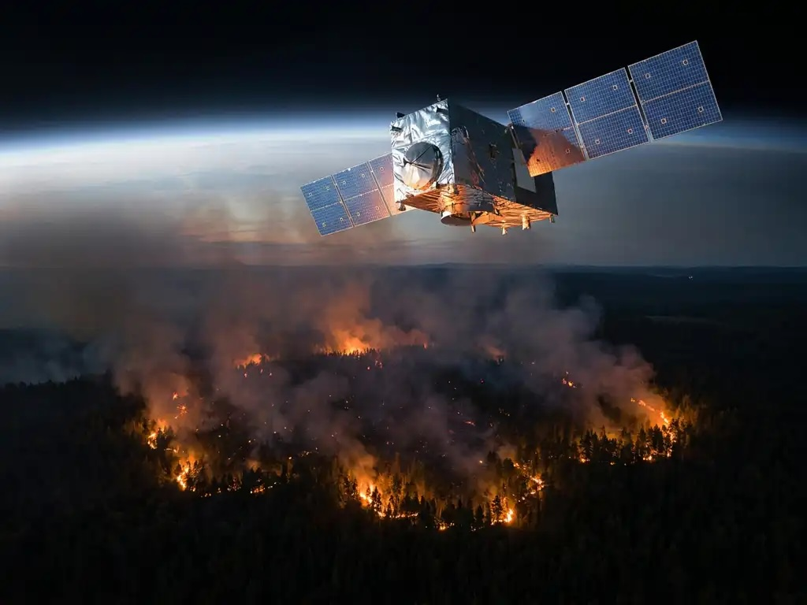

# Fire Scars False Color Visualization 

<p align="center">
  
</p>

## About 

This repository contains the materials for the [fourth homework assignment](https://meds-eds-220.github.io/MEDS-eds-220-course/assignments/assignment4-palisades-eaton-fires.html) for [EDS 220: Working with Environmental Datasets](https://bren.ucsb.edu/courses/eds-220), a course that is part of the Master of Environmental Data Science program completed at the Bren School of Environmental Science and Management.

Satellite data from instruments (E.g. Landsat) are used to create false color imagery by assigning infrared bands to visible colors which highlight important aspects like vegetation health, burn severity, and the extent of fire scars that assist researchers and land managers to assess recovery efforts, identify high-risk areas, and plan restoration strategies.


The homework assignment focuses on the Palisades and Eaton fires, foothill, and coastal wildland-urban zones in Los Angeles County, that occurred almost simultaneously around the start of January in 2025. From the two fires, thousands of homes were destroyed and displaced tens of thousands of residents, as well as inflicting ecological and infrastructural damage.


For this assignment, the final output should be a false color image of the Eaton and Palisades fire through remote sensing data highlighting the fire scar. The importance of the assignment is to explore how data visualization and coding support environmental monitoring.

## Highlights

- Restoration of CRS through exploratory retrieval using the correct variable, `spatial_ref.crs_wkt`.

- Correct true color imagery by filling in `NaN` values with 0 for bands using RGB (visible light).

- False color imagery using short-wave infrared, near-infrared, and red to distignuish healthy vegation from burned areas.

- Creating a false color image and depicting the fire perimeters using boundaries to represent Palisades and Eaton fires.

## Repository Structure

```
eds220-hwk4
├── hwk4-task2-false-color-hernandez.ipynb
├── image
├── LICENSE
└── README.md

```

The `data` for both `landsat8` as well as the fire perimeter which represent both `Palisades` and `Eaton` are not housed here due to the file size. Though, details below can be read to acquire through an independent search.

The ipynb that contains the code is called `hwk4-task2-false-color-hernandez.ipynb`.

*Note: Perimeter for Palisades is spelled incorrectly in the data and used accordingly in the notebook*

## Data

The `landsat8` data was given by the professor in a google drive, but can accessed through [Microsoft Planetary Computer data catalog](https://planetarycomputer.microsoft.com/dataset/landsat-c2-l2).

The data for the `Palisades` can be downloaded directly [here](https://hub.arcgis.com/datasets/lacounty::palisades-and-eaton-dissolved-fire-perimeters-2025/explore?layer=1&location=34.133841%2C-118.349462%2C10) and `Eaton` data [here](https://hub.arcgis.com/datasets/lacounty::palisades-and-eaton-dissolved-fire-perimeters-2025/explore?layer=0&location=32.162108%2C-115.753942%2C7). Both were found using Google search with the first results titled, Palisades and Eaton Dissolved Fire Perimeters (2025), which is housed on [ArcGISHub](https://hub.arcgis.com/maps/ad51845ea5fb4eb483bc2a7c38b2370c/about).


## References

County of Los Angeles. (2025). *Palisades and Eaton dissolved fire perimeters*
[Dataset]. ArcGIS Hub. https://hub.arcgis.com/maps/ad51845ea5fb4eb483bc2a7c38b2370c 

NASA. (2025, December 8). *Why is that forest red and that cloud blue? How to interpret a false-color satellite image*. https://science.nasa.gov/earth/earth-observatory/how-to-interpret-a-false-color-satellite-image/

U.S. Geological Survey. (2025). Landsat Collection 2 Level-2 [Dataset]. Microsoft Planetary Computer. https://planetarycomputer.microsoft.com/dataset/landsat-c2-l2 